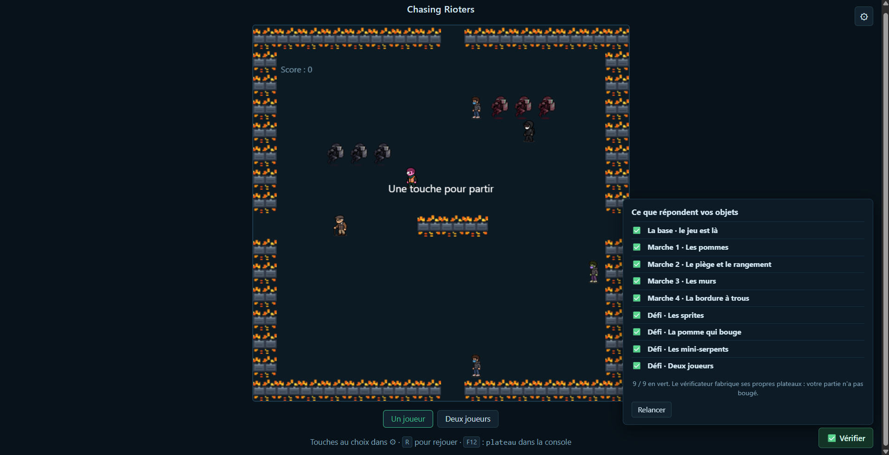
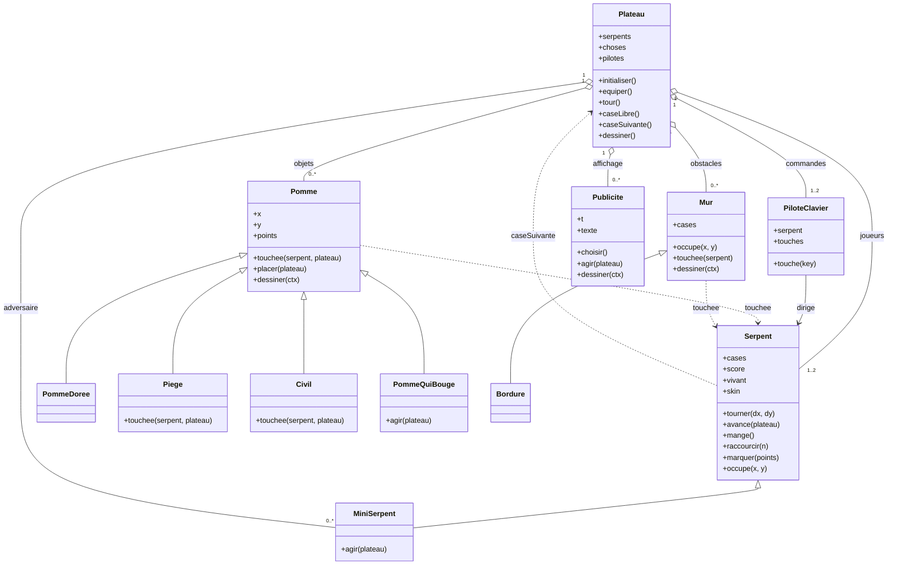

# CHASING RIOTERS - Parviendrez-vous à casser du manifestant ?

## 1. Présentation du jeu (trois lignes)

Dans  Chasing Rioters , on dirige une file de CRS qui poursuit des manifestants à la place de manger des pommes.
Chaque personnage capturé produit un effet différent (points, allongement ou pénalité), tandis que des obstacles, un adversaire autonome et des publicités viendront régulièrement gêner votre progression.
Le jeu propose des animations en pixel art, des bruitages, des réglages personnalisables et un mode à deux joueurs.

Le projet utilise volontairement l'humour et l'absurde pour évoquer les tensions entre forces de l'ordre et manifestants. Derrière la caricature, je voulais aussi rappeler que les personnes des deux côtés sont humaines, et qu'il serait préférable de pouvoir dialoguer plutôt que de s'affronter. L'idée m'est venue en regardant le Snake du cours : « Et si les pommes étaient des gens ? Et si le serpent était une file de CRS ? ». Et comme le professeur ne m'a pas dit "non, s'il te plaît, un peu de sérieux Boris", 

### Capture d'écran



### Comment jouer ?

Ouvrir `index.html` dans un navigateur (ou accéder au site directement hébergé sur GitHub), puis appuyer sur une touche pour commencer. Les flèches du clavier et/ou les touches ZQSD ou IJKL permettent de diriger les joueurs, selon la configuration choisie dans les réglages. Le bouton  Un joueur / Deux joueurs  permet de changer de mode ;  R  recommence une partie.Espace la démarre.Enfin, le panneau ⚙ permet de choisir l'apparence des CRS, la disposition des touches, la couleur de fond et la musique. 

Le but est de capturer les personnages qui rapportent des points sans heurter les obstacles, les autres occupants ou sa propre file.

## 2. Point de départ et démarche

Je suis parti de  `snake-objet-marche-4-corrige` , le corrigé du travail réalisé en cours. Au départ, j'avais encore du mal à comprendre comment construire un objet, ce qu'une classe devait faire et, surtout, comment les objets communiquaient entre eux. J'aurais pu demander à une IA de recréer un jeu complet, mais je préférais partir de la même base que celle étudiée par tout le monde : je pouvais ainsi revenir aux exemples du cours lorsque je bloquais et comprendre progressivement mes modifications.

J'ai travaillé seul. Ce qui veut dire que je me suis occupé du concept, de la personnalisation du jeu, de l'intégration, des essais, du sound design, de la gestion de projet, etc etc etc. J'ai utilisé ChatGPT comme aide ponctuelle, principalement pour les sprites, certaines fonctions JavaScript et la résolution de bugs ; ElevenLabs a servi à synthétiser une voix. Mais ne nous perdons pas dans les détails ici : j'aurai l'occasion de vous en reparler plus bas. 

## 3. Fonctionnalités du jeu

| Fonctionnalité | Fonctionnement dans le code |
| --- | --- |
| Personnages à capturer | `Pomme` (10 points et croissance), `PommeDoree` (50 points et croissance), `Civil` (25 points et bruitage), `Piege` (raccourcit le serpent de deux segments), `PommeQuiBouge` (change de position périodiquement). |
| Sprites animés | Les personnages sont dessinés à partir de feuilles d'animation en format PNG ; la fonction `sprite()` sélectionne une frame avec `drawImage()`. |
| Apparences personnalisées | `SKINS` propose  CRS classique ,  Tätma Traque  et  Mai 68  sans créer trois classes de serpents. |
| Mode deux joueurs | `Plateau` crée un ou deux `Serpent`, chacun associé à un `PiloteClavier`, à des touches et à un score. |
| Paramètres | Listes `SKINS`, `CONFIGS`, `FONDS` et menu de sélection musicale. |
| Sons | Son de départ, musiques de fond et effets lors des rencontres avec certains personnages. |
| Obstacles | Murs, bordure avec passages et `MiniSerpent` contrôlé automatiquement. |
| Publicités intrusives | `Publicite` affiche un panneau à une position aléatoire pendant que la partie continue derrière. |


## 4. CARTE CRC - `Publicite`

| Classe | Responsabilités | Collaborateurs |
| --- | --- | --- |
|  `Publicite`  | Compter les tours ; choisir un message et une position ; décider quand la publicité est visible ; dessiner le panneau et faire défiler son texte. |  `Plateau` , qui appelle `agir()` et `dessiner()` ; le contexte graphique  Canvas  (`ctx`) utilisé pour afficher la publicité. |

Cette classe représente bien mon ajout personnel : je voulais que les publicités fassent partie du jeu, sans que `Plateau` doive gérer directement leurs textes et leur affichage. En donnant ces responsabilités à `Publicite`, j'ai pu intégrer ce nouvel objet à la liste `choses` et lui faire recevoir les mêmes messages que les autres objets du plateau. Il répond aussi à `occupe()` (toujours `false`) et à `touchee()` (aucun effet), car une publicité n'est pas un obstacle physique : elle masque seulement la vue du joueur.

## 5. Cartes CRC des classes du projet

Les cartes ci-dessous décrivent les classes présente dans le snake.js. Elles ne signifient pas que je les ai toutes créées de zéro : plusieurs viennent du corrigé ou des exercices du cours, puis ont été réutilisées ou adaptées. Mes ajouts les plus personnels concernent notamment `Civil`, `Publicite`, les apparences, les sons et les réglages. Je n'ai pas trop trop touché aux choses qui étaient là de base, donc si vous voyez des champs vide ci-dessous c'est que la logique CRC était déjà présentée dans le cours de base. 

### `Serpent`


### `MiniSerpent` -hérite de `Serpent`

| Responsabilités | Collaborateurs |
| --- | --- |
| Se déplacer automatiquement et parfois changer de direction au hasard ; éviter une case déjà occupée. | `Plateau` (`caseSuivante`, `occupants`) ; `Serpent` (méthodes héritées). |

### `PiloteClavier`

### `Pomme`

### `PommeDoree` -hérite de `Pomme`

| Responsabilités | Collaborateurs |
| --- | --- |
| Conserver le comportement d'une `Pomme`, mais avec une image particulière et  50 points . | `Pomme` (comportement hérité) ; `Plateau` ; `Serpent`. |

### `Piege` -hérite de `Pomme`

| Responsabilités | Collaborateurs |
| --- | --- |
| Remplacer le gain de points par une pénalité : retirer  deux segments , jouer son effet sonore et changer de place. | `Serpent` (`raccourcir`) ; `Plateau` (`caseLibre`). |

### `Civil` -hérite de `Pomme`

| Responsabilités | Collaborateurs |
| --- | --- |
| Utiliser un sprite et un son spécifiques ; donner  25 points  à la capture et se replacer. Dans ma version corrigée, provoquer aussi la croissance du serpent. | `Serpent` (`marquer`, et `mange` après correction) ; `Plateau` (`caseLibre`) ; `Pomme` (placement et dessin hérités). |

### `PommeQuiBouge` -hérite de `Pomme`

| Responsabilités | Collaborateurs |
| --- | --- |
| Compter les tours et tenter un déplacement aléatoire tous les quatre tours. | `Plateau` (`caseSuivante`, `occupants`) ; `Pomme` (comportement hérité). |

### `Publicite`

| Responsabilités | Collaborateurs |
| --- | --- |
| Choisir et afficher des messages publicitaires, gérer leur durée et leur position, découper et faire défiler le texte, sans bloquer les collisions ni les déplacements. | `Plateau` (boucle du jeu et dessin) ; Canvas (`ctx`). |

### `Plateau`

| Responsabilités | Collaborateurs |
| --- | --- |
| Initialiser et recommencer une partie ; créer les objets ; attribuer les pilotes et les paramètres ; trouver des cases libres ; calculer les déplacements ; exécuter les tours ; organiser les contacts, le dessin et le lancement des sons. | `Serpent`, `PiloteClavier`, `MiniSerpent`, `Pomme` et ses sous-classes, `Mur`, `Bordure`, `Publicite`. |

## 6. Diagramme de classes



## 7. Mes choix de conception : qui fait quoi, et pourquoi ?

 Personnages et effets de capture : La base du cours utilisait déjà les pommes et leur héritage. J'ai repris ce mécanisme pour transformer les pommes en personnages. L'effet de chaque contact appartient à l'objet touché (`touchee()`), et non à une grande série de conditions dans `Plateau`. Cela évite à `Plateau` de devoir connaître les règles propres à chaque personnage. `Civil` illustre mon adaptation : son sprite, son son et son nombre de points sont spécifiques. `Piege`, `MiniSerpent`, `Mur` et `Bordure` viennent pour l'essentiel des mécanismes étudiés en cours, que j'ai conservés plutôt que les réinventer artificiellement.

 Apparences et options : Je voulais que les joueurs puissent varier leur expérience : personnages différents, touches adaptées à leurs habitudes, arrière-plans et musiques au choix. J'ai préféré un tableau `SKINS` à trois classes de CRS : seuls les visuels changent, pas les règles du personnage. Créer trois classes supplémentaires pour remplacer `this.img` aurait surtout ajouté des répétitions. `Plateau.regler()` garde les paramètres et `Plateau.equiper()` affecte aux serpents leur apparence et leur pilote.

 Deux joueurs : `Plateau` sait combien de serpents créer et quel score appartient à quel joueur. `PiloteClavier`, déjà présent dans la structure du corrigé, est chargé de traduire les touches en directions. La difficulté principale a été la  sélection des configurations de touches , pour éviter que les commandes des deux joueurs soient confondues. Le principe de plusieurs serpents m'était plus familier grâce au travail sur `MiniSerpent`.

 Animations (fonction `sprite()`) : Plutôt que de multiplier les fonctions de dessin, j'utilise une seule fonction qui calcule la largeur d'une image d'animation, choisit la frame en fonction du temps écoulé, puis la dessine au centre d'une case. J'ai demandé de l'aide à ChatGPT pour cette fonction, que j'ai ensuite intégrée à mes images.

 Audio : Les fichiers audio sont associés à des fonctions réutilisables. Les objets qui déclenchent un bruitage conservent leur son, tandis que `Plateau` gère le début et l'arrêt de la musique. J'ai séparé l'effet sonore de départ et la musique par  4,5 secondes  : cela évite de superposer trop de sons, laisse entendre l'introduction et crée une petite attente.

 Publicités : L'idée vient notamment des longues pubs non désactivables sur Dailymotion et des jeux sur navigateur des années 2010. Je voulais une parodie des publicités intrusives, mais aussi un obstacle original : le plateau reste actif, alors que le joueur doit mémoriser ce qui se trouve derrière la zone cachée. Le compteur de `Publicite` fonctionne sur un cycle de  400 tours  et affiche le panneau pendant  63 tours  environ. Avec un tour toutes les  120 ms , cela représente approximativement  48 secondes entre deux débuts de cycle  et  7,6 secondes d'affichage . La publicité n'est pas une modale HTML : elle est dessinée  directement sur le Canvas , par-dessus les personnages, sans interrompre la partie.

## 8. Deux vrais problèmes rencontrés et comment je les ai résolus

### Problème 1 -Les publicités devenaient illisibles

C'est le bug qui m'a le plus fait galérer. Dès que je mettais un message publicitaire un peu long, le texte ne tenait plus correctement dans le panneau : il était coupé ou devenait illisible. J'ai d'abord tenté d'insérer des balises `<br>`, puis d'agrandir la zone de dessin. Cela ne réglait pas le problème, parce que `ctx.fillText()` ne traite pas les balises HTML `</br>` comme des retours à la ligne et n'effectue pas automatiquement la mise en page d'un paragraphe.

Après plusieurs essais infructueux, j'ai finalement demandé à ChatGPT de m'aider à créer un système de retour à la ligne et de défilement automatique. Le code actuel découpe le message en mots, utilise `ctx.measureText()` pour décider quand passer à la ligne, interprète le marqueur `</br>` utilisé dans mes messages et applique une zone de découpe avec `ctx.clip()`. La variable `scroll` fait progressivement défiler les lignes. J'ai constaté que cette approche fonctionnait mieux avec mes longs textes publicitaires.

### Problème 2 -Certaines captures ne déclenchaient plus les bons effets

J'ai rencontré l'erreur JavaScript suivante dans la console du navigateur :

```text
Uncaught TypeError: this.son is not a function
    at Pomme.touchee (...)
    at Plateau.tour (...)

Uncaught TypeError: this.son is not a function
    at Piege.touchee (...)
    at Plateau.tour (...)
```

Dans le jeu, cela se manifestait par des collisions avec plusieurs personnages qui ne produisaient plus leur effet correctement. La console m'a indiqué la méthode en cause : l'appel `this.son()` au moment du contact. J'ai transmis ces messages d'erreur à ChatGPT pour obtenir de l'aide au débogage. Dans la version du code fournie, chaque type concerné reçoit une fonction de lecture sonore depuis `SONS`, créée par `son()`, ce qui permet de l'appeler avec `this.son()`. Je ne peux cependant pas reconstituer précisément toutes les modifications intermédiaires à partir du seul fichier final.

### Problème 3 -Les animations n'étaient pas exploitables au départ

Au début, je voulais simplement remplacer les PNG de l'exemple du professeur par des GIF animés. J'ai découvert que cette solution ne donnait pas l'animation attendue dans le Canvas : je me retrouvais avec une image figée. J'ai donc converti l'idée en spritesheets (plusieurs frames côte à côte) et utilisé une fonction JavaScript pour afficher successivement chaque frame.

Les premières feuilles générées étaient trop petites : dans les cases du jeu, les personnages devenaient difficilement visibles. Il a fallu environ quatre ou cinq tentatives avec ChatGPT pour obtenir des dimensions satisfaisantes. J'ai ensuite réutilisé les premières feuilles réussies comme références visuelles pour obtenir des personnages cohérents. Il y a aussi eu un problème particulièrement absurde avec `animation-mai68-sheet.png` : au lieu de courir, le personnage semblait léviter et trembler. En redonnant à ChatGPT des références d'animations plus précises, j'ai obtenu une version qui convenait davantage.

## 9. Usage des intelligences artificielles : transparence et vérifications

### Quels outils, pour quelles missions ?

| Outil | Missions | Ce que j'ai contrôlé |
| --- | --- | --- |
|  ChatGPT  (génération d'images) | Conception de sprites de CRS et de manifestants, puis variantes et feuilles d'animation. | Lisibilité, proportions, nombre de frames, animation, cohérence entre personnages et dimensions adaptées à l'affichage dans le jeu. |
|  ChatGPT  (assistant de programmation) | Aide pour `sprite()` ; ajout du choix musical ; résolution du problème `this.son is not a function` ; mise en page et défilement des publicités. | Intégration au code du cours, comportement dans le navigateur, fonctionnement des effets, lisibilité des textes et compatibilité avec les réglages existants. |
|  ElevenLabs  | Synthèse d'une voix masculine âgée pour le son associé au civil, à partir d'un prompt vocal préparé avec ChatGPT. | Rendu sonore et intégration du fichier dans le jeu. |

Je n'ai pas demandé à une IA de produire entièrement le projet à ma place. Je suis parti du corrigé du cours, puis j'ai modifié les fonctionnalités en fonction de mes idées, en demandant de l'aide lorsque mes compétences techniques ou artistiques ne suffisaient pas. Je ne sais pas dessiner du pixel art, et le délai de remise du 8 novembre m'incitait à investir davantage mon temps dans l'intégration et la programmation plutôt que dans le dessin de chaque frame.

### Exemples de prompts réellement utilisés

 1. Préparation des sprites avec ChatGPT (début de la conversation) 

> « j'aimerais ton aide : je voudrais générer deux gif sans arrière-plan, et en pixel art, dans le style de ceux que je te joint ci-dessus. Un avec un CRS en train de courir, et un autre avec une jeune homme portant un masque FFP2 en position idle. [...] si tu peux me poser des questions très précises pour réaliser le prompt le plus précis et le plus complet possible [...] »

À partir des questions proposées par ChatGPT, j'ai construit des prompts détaillés en anglais. Par exemple, celui du CRS commençait ainsi :

> « Create a  production-ready 2D pixel art animation sprite sheet  depicting a French CRS riot police officer running energetically toward the RIGHT. »

Il précisait aussi  8 frames ,  8 colonnes × 1 ligne , des cellules  64 × 64 , un fond transparent, une animation qui boucle, des contours noirs et une esthétique de jeu 2D rétro. Le prompt du manifestant masqué demandait notamment un personnage immobile, un masque bleu `#67BCF0`, un sweat gris `#5A5E6B`, des baskets blanches à bandes rouges, et  8 frames  d'animation *idle*. ; ces valeurs décrivent les consignes envoyées, pas une garantie que chaque fichier généré respectait immédiatement ces dimensions.

 2. Ajout d'un choix musical (ChatGPT) 

> « saluuut, j'aimerais que tu t'inspires du fonctionnement du menu réglages actuel pour ajouter une Class Setlist avec son propre menu déroulant en HTML. [...] Si j'appuie sur “Megalovania”, je veux que, quand je lancerais ma partie, au lieu de willofthepeople, ça lance megalovania. [...] j'aimerais que tu fasses ça avec le moins de lignes de codes et avec la méthode la plus simple que tu connaisses possibles. »

Le résultat final ne contient pas de classe `Setlist` : pour rester simple, la sélection passe par le `<select id="musique">`, la variable `musique`, l'objet `SONS` et un événement `onchange`.  Megalovania figurait dans l'exemple de mon prompt, mais pas dans la liste musicale du fichier final fourni , qui contient *Will of the People* et *The Hanging Tree*.

 3. Débogage d'une erreur de son (ChatGPT) 

> « j'ai ça en erreur : `Uncaught TypeError: this.son is not a function` [...] ça se matérialise par le fait que j'ai plus de collision avec plusieurs des manifestants »

J'ai fourni à l'IA le message d'erreur et l'effet observé pendant le jeu plutôt que de demander une réécriture totale du programme.

 4. Défilement des publicités (ChatGPT) 

Je lui ai expliqué que `fillText()` ne gérait pas les longs textes comme je le voulais et que mes essais avec `<br>` ou l'agrandissement de la boîte n'avaient pas fonctionné. Je lui ai demandé une fonction qui  revienne automatiquement à la ligne et fasse défiler le texte , avec ou sans retours à la ligne explicites. Je n'ai plus le texte exact de cette demande ; je préfère donc en donner le contenu plutôt qu'inventer une citation mot pour mot.

 5. Création de la voix du civil (ElevenLabs ; prompt préparé avec ChatGPT) 

> « A highly realistic elderly French male voice, around 75–85 years old, with an authentic native Metropolitan French accent. Deep, aged, slightly raspy and gravelly voice [...] Extremely sarcastic, indignant, theatrical and effortlessly funny [...] Not cartoonish, not robotic, not overly frail, not a caricature. »

Ce prompt servait à définir le  timbre et l'interprétation  de la voix, pas à programmer le jeu.

> [!INFO]
>Les prompts complets sont d'ailleurs fournis dans [une autre annexe](PROMPTS-IA-Chasing-Rioters.md).

## 10. Musiques, bruitages et sources

- `depart.mp3` : montage que j'ai réalisé moi-même sur un site de mixage audio en MP3, en combinant un [son de canon *Hunger Games*](https://www.myinstants.com/fr/instant/hunger-games-cannon-17653/) et le [sifflement de Rue](https://www.myinstants.com/en/instant/mockingjay-whistle/).
- `civil.mp3` : voix de synthèse générée sur ElevenLabs .
-  `grenade.mp3`  : extrait sonore tiré de [cette vidéo YouTube](https://www.youtube.com/watch?v=S_TxruHTGOk), environ de  0:00 à 0:04 .
-  `piege.mp3`  : effet d'explosion récupéré en ligne, puis intégré par mes soins ; je n'ai malheureusement pas conservé l'URL de la source.
-  `willofthepeople.mp3`  : *Will of the People* - Muse .
-  `hungergames.mp3`  : *The Hanging Tree* -interprétation du  Danish National Symphony Orchestra avec Andrea Lykke .
- `modale` : [original trouvé sur FreeFrontEnd]( https://freefrontend.com/css-modal-windows/#2026-03-03-cyberpunk-glitch-upgrade-modal-l)

Ces musiques et extraits sont des œuvres tierces ; leur intégration dans un projet scolaire ne signifie pas qu'ils sont libres de droits. Le détail des sources (niveau liens internet) est également consigné dans `README-inspirations.md` du dossier `inspirations`.

## 11. Travail individuel, tests et limites

Ce projet a été réalisé individuellement, avec des outils d'IA pour m'aider ponctuellement. Je me suis occupé de l'idée, des choix de fonctionnalités, des essais, de la sélection des ressources et de l'assemblage du jeu. L'IA a notamment aidé à produire des visuels, à proposer certains morceaux de code et à expliquer des bugs, mais c'est moi qui ai choisi ce que je conservais et qui l'ai intégré à la base étudiée en cours.

Les fonctionnalités principales sont présentes et utilisables dans ma version de travail, même si tout n'est pas parfait.  Je n'ai pas pu tester de manière exhaustive les collisions en mode deux joueurs , car piloter deux personnages en même temps, tout seul, n'est pas très pratique. Il faut donc garder cette limite en tête. Le comportement exact du jeu peut également dépendre des fichiers du dossier `sprites/`, du dossier `sons/` et de la version finale de `snake.js` remise.

Ce que je retiens surtout, c'est que partir d'un corrigé que je pouvais relire m'a aidé à mieux identifier les responsabilités des objets. J'ai compris l'intérêt de donner à chaque personnage son propre comportement lors d'un contact, d'éviter de multiplier inutilement les classes pour de simples changements d'apparence et d'isoler les publicités dans une classe dédiée. J'ai également appris que des problèmes visuels ou sonores peuvent nécessiter des solutions très concrètes dans le code, et qu'il vaut mieux tester une proposition d'IA que supposer qu'elle fonctionne immédiatement.
